<!-- ======================= LR-OS · README de perfil =======================
     Gerado por build.mjs a partir de profile.config.mjs.
     A Action .github/workflows/readme.yml atualiza nível, XP e estatísticas todo dia.
     ========================================================================= -->

<a href="https://reislucasf.com.br"></a>

<a href="https://reislucasf.com.br"></a>

  

<!-- ============================ FICHA ============================ -->
<a href="https://reislucasf.com.br"></a>

<!-- ============================ MAPA ============================ -->
<a href="https://reislucasf.com.br/#trajetoria"></a>

<!-- ============================ MISSÕES ============================ -->
<a href="https://reislucasf.com.br/#projetos"></a>

<!-- ============================ INVENTÁRIO ============================ -->

<!-- ============================ CONQUISTAS ============================ -->

<!-- ============================ MINIGAME ============================ -->
<a href="https://github.com/reislucasf?tab=repositories"></a>

<!-- ============================ REGISTRO ============================ -->
<a href="https://github.com/reislucasf?tab=repositories">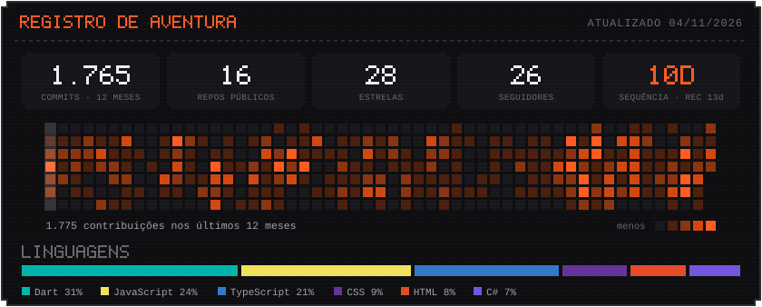</a>

<!-- ============================ CONTINUE ============================ -->

  

<!-- ============================ RODAPÉ ============================ -->

